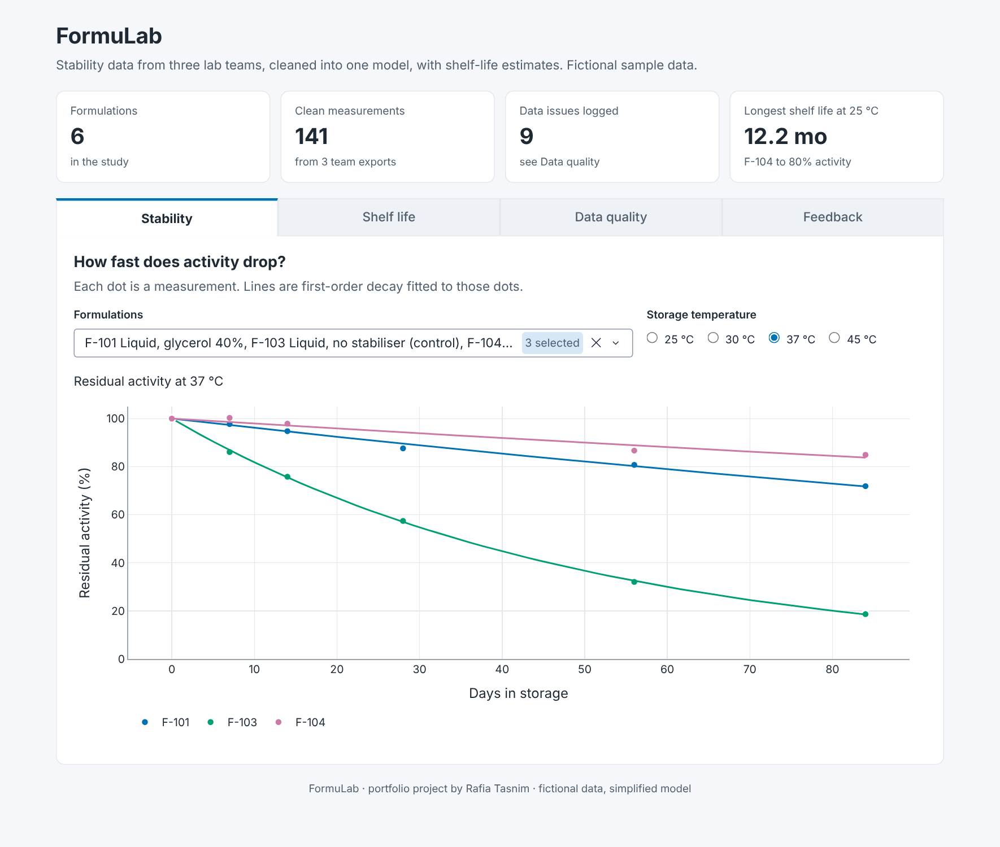
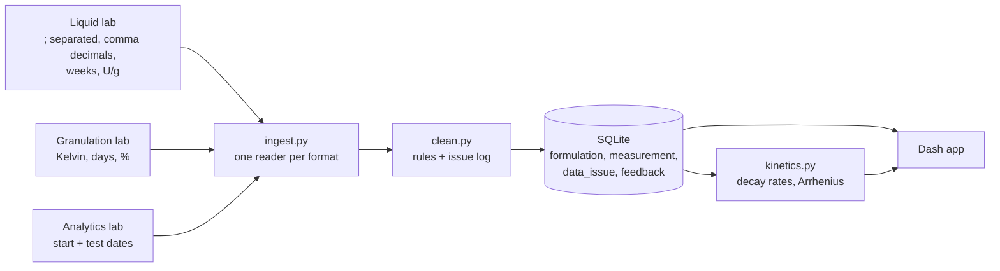
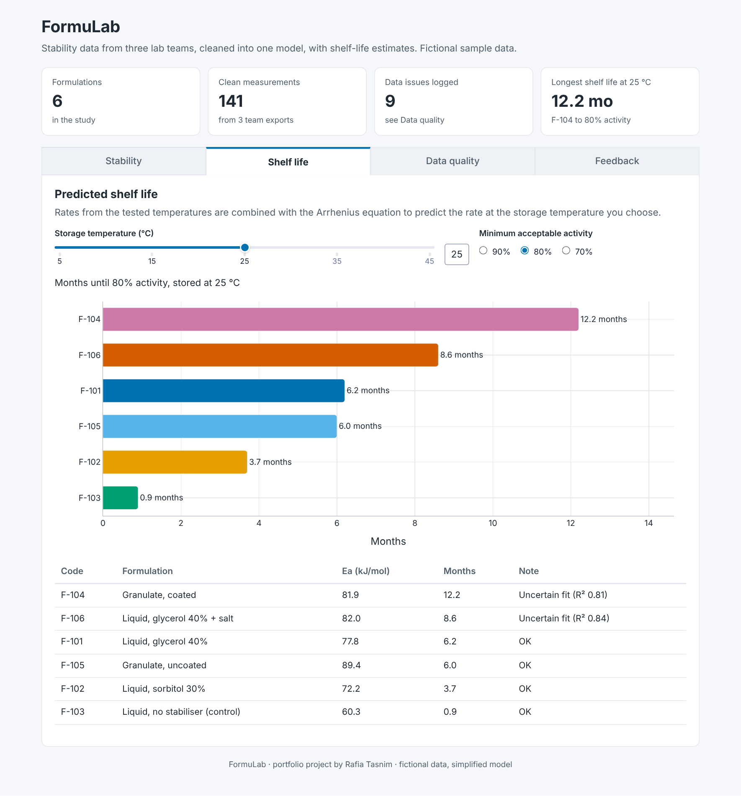
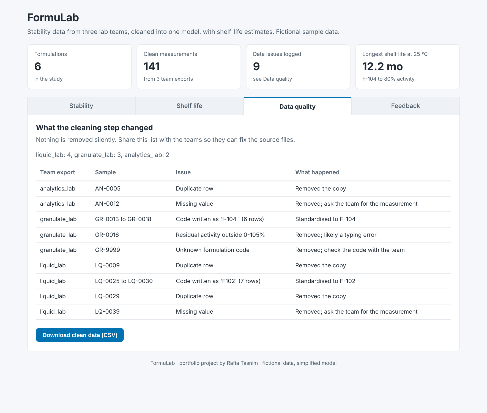

# FormuLab

**A Python and Dash app that brings stability data from several lab teams into one clean data model, shows how fast each formulation loses activity, and estimates shelf life at any storage temperature.**

In product development, stability results often arrive from different teams in different formats: one uses weeks and comma decimals, another Kelvin, another start and test dates. Before anyone can compare formulations, someone has to clean and combine the files by hand. FormuLab does that step automatically, logs every change it makes, and gives scientists an interactive view of the results.



> **Note:** all formulations, measurements and results are fictional and generated by `generate_sample_data.py`. The kinetic model is a deliberate simplification for learning purposes.

---

## What it does

| Tab | What you can do |
| --- | --- |
| **Stability** | Pick formulations and a temperature; see measured residual activity (dots) and the fitted decay curve (lines) |
| **Shelf life** | Choose a storage temperature (5–45 °C) and a minimum activity (90/80/70%); see predicted months per formulation, with warnings when a fit is uncertain or the temperature is outside the tested range |
| **Data quality** | See every problem the cleaning step found and what it did, and download the clean data as CSV |
| **Feedback** | Users write what would make the tool more useful; it is saved in the database for planning the next version |

## How it works



**1. Ingest.** Each team's export has its own reader in `formulab/ingest.py`. All readers return the same six columns, so the rest of the code never needs to know where a row came from. The liquid lab reports absolute activity in U/g, which is converted to % of the day-0 value.

**2. Clean.** `formulab/clean.py` standardises formulation codes (`f-104 ` and `F102` become `F-104` and `F-102`), and removes unknown codes, missing values, duplicates and impossible values (above 105% residual activity). **Every change is written to an issue log**, which the Data quality tab shows. On the sample data it finds 9 issues across the three exports.

**3. Store.** `formulab/db.py` defines a small SQLite data model with foreign keys and a check constraint, and all queries the app uses are written in SQL.

**4. Model.** `formulab/kinetics.py` fits:

- **First-order decay** per formulation and temperature: residual = 100 × e^(−k·t), fitted by least squares on ln(residual/100).
- **Arrhenius** across temperatures: ln k = ln A − Ea / (R·T), to predict k at the chosen storage temperature.
- **Shelf life** = ln(100 / threshold) / k, shown in months.

A prediction is marked *Uncertain fit* when any temperature has R² below 0.90, and *Outside tested temperatures* when it is an extrapolation. In the sample, the two most stable formulations get the uncertain warning: when activity barely drops at 25–30 °C, measurement noise dominates the fit. A good tool should say that rather than hide it.



## Getting started

Requires Python 3.10 or newer.

```bash
git clone https://github.com/Rafia180/formulab.git
cd formulab
python -m venv .venv
source .venv/bin/activate              # Windows: .venv\Scripts\activate
pip install -r requirements-dev.txt

python generate_sample_data.py         # optional: recreate the fictional exports
python build_db.py                     # clean the exports into data/formulab.db
python app.py                          # open http://127.0.0.1:8050
```

Run the checks:

```bash
ruff check .
python -m pytest -q                    # 15 tests
```

## Step by step: how the project was built

1. **Defined the user need.** Scientists from several teams need one trustworthy view of stability results, without cleaning files by hand.
2. **Created realistic sample data** with three export formats and nine planted problems, so the cleaning rules could be tested against known answers.
3. **Wrote one reader per format** and agreed one shared set of columns.
4. **Wrote the cleaning rules with an issue log**, so nothing is removed silently.
5. **Designed the SQLite data model** and wrote the queries in SQL.
6. **Added the kinetics model**, then tested it on synthetic data where the true rate and activation energy are known.
7. **Built the Dash app** from reusable components (`components.py`) and pure chart functions (`figures.py`), with thin callbacks.
8. **Added a feedback tab**, so user needs can be collected inside the tool.
9. **Set up GitHub Actions CI** (lint, database build, tests on Python 3.11 and 3.13), issue templates, a pull request template and branch rules in `CONTRIBUTING.md`.

## Project structure

```
formulab/
├── data/raw/                 fictional exports from three teams + formulation list
├── formulab/
│   ├── ingest.py             one reader per team format
│   ├── clean.py              cleaning rules and issue log
│   ├── db.py                 SQLite schema and SQL queries
│   ├── kinetics.py           decay rate, Arrhenius, shelf life
│   ├── components.py         reusable layout pieces
│   ├── figures.py            chart builders
│   ├── pipeline.py           raw files -> clean database
│   └── app.py                Dash layout and callbacks
├── tests/test_formulab.py    15 pytest tests
├── .github/                  CI workflow, issue and PR templates
├── AGENTS.md                 instructions for AI coding assistants
├── CONTRIBUTING.md           branch, commit and pull request rules
├── build_db.py
└── app.py
```

## How I built it

I built FormuLab with an AI coding assistant as a pair programmer, and the AI wrote much of the code. My part was:

1. Turning the problem into requirements: which formats to support, which cleaning rules, what the user should see.
2. Designing the sample data so every rule has a known problem to find.
3. Checking the results: the tests prove the model recovers known rates and activation energies, and I compared the issue log with the problems I planted.
4. Reviewing the user interface on desktop and phone sizes.

`AGENTS.md` shows how I guide an AI assistant in a repository: the data flow, the rule that every change to data is logged, and that every calculation needs a test.

## Limitations and next steps

- First-order decay and Arrhenius are simplifications; real formulations can show other behaviour (for example, a fast initial drop).
- No confidence intervals yet; the next step is a bootstrap interval for each shelf-life estimate.
- Next features (good first issues): compare two temperatures in one chart, upload a new export from the browser, and a log-scale view of the Arrhenius fit.



## Author

**Rafia Tasnim**, BSc Computer Science student, Niels Brock Copenhagen Business College
[LinkedIn](https://www.linkedin.com/in/rafia-tasnim26) · [GitHub](https://github.com/Rafia180)
